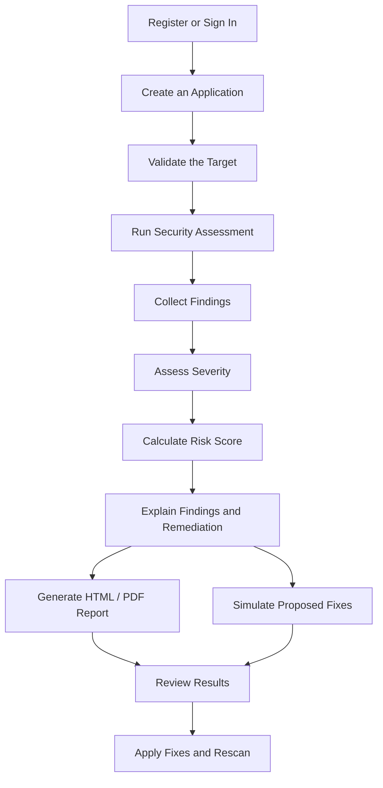
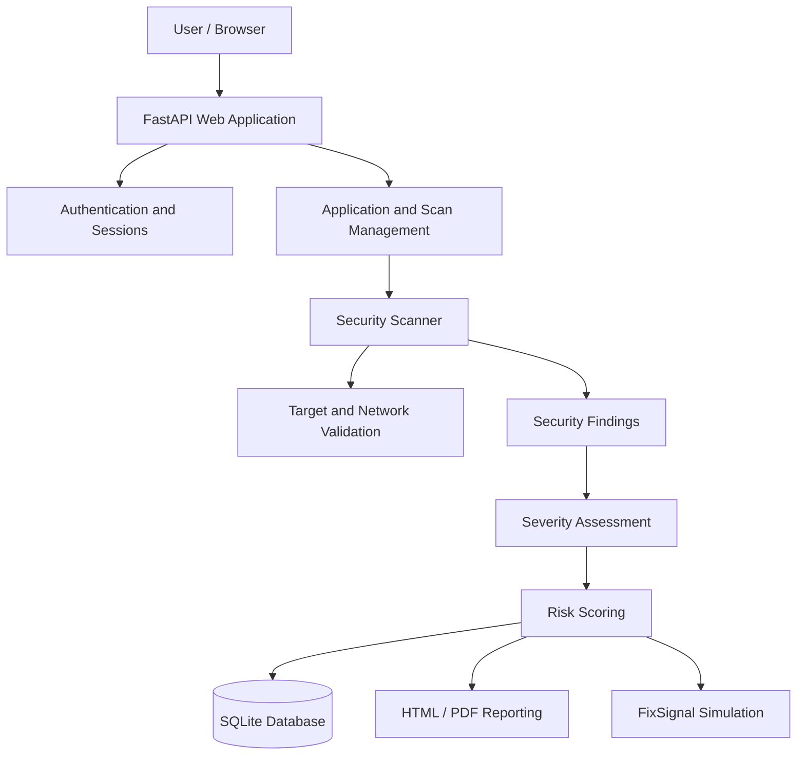

# ◈ VALORYNN

### Intelligent Application Security Assessment

<p align="center">
  <strong>DISCOVER · UNDERSTAND · REMEDIATE · VERIFY</strong>
</p>

<p align="center">
  An application security assessment platform that helps developers understand findings,
  evaluate risk, and make informed remediation decisions.
</p>

<p align="center">
  <a href="https://github.com/ashfaqhyder/Valorynn">
    
  </a>
  
  
  
</p>

<p align="center">
  <a href="#overview">Overview</a> ·
  <a href="#features">Features</a> ·
  <a href="#how-it-works">How It Works</a> ·
  <a href="#architecture">Architecture</a> ·
  <a href="#getting-started">Get Started</a>
</p>

---

## 01 — Overview

**Valorynn** is a web-based application security assessment platform designed to make
security findings easier to understand and act upon.

It brings security scanning, severity assessment, risk scoring, remediation guidance,
and reporting together in one workflow. The objective is to help users understand
**what was detected, why it matters, what they can do about it, and how to verify an
improvement.**

### The assessment workflow

| Discover | Assess | Improve | Verify |
| --- | --- | --- | --- |
| Inspect an authorized target | Review findings and severity | Follow remediation guidance | Rescan and compare results |

## 02 — Features

<details open>
<summary><strong>01. Application Security Scanning</strong></summary>

Assess configured application targets and inspect the evidence collected by the scanner.

- HTTP and HTTPS target validation.
- Security-related response and configuration checks.
- Protection against private-network targets and DNS-rebinding attacks.
- Redirect restrictions and TLS validation.
- Bounded response-body inspection.

Scanning results depend on the checks performed and the evidence available. Valorynn
should not be interpreted as a guarantee that an application is free from vulnerabilities.

</details>

<details>
<summary><strong>02. Severity Assessment and Risk Scoring</strong></summary>

Organize findings by severity and translate available evidence into a security score.

- Severity classification supported by a machine-learning component.
- Use of authoritative severity information when available.
- A bounded security score with an explanation of deductions.
- A summary of detected findings by severity.
- Explicit indication when an assessment is incomplete.

A score is an assessment aid, not a formal certification or proof of security.

</details>

<details>
<summary><strong>03. Actionable Remediation Guidance</strong></summary>

Move from identifying a finding to understanding how to address it.

- Plain-language explanations of findings.
- Practical remediation recommendations.
- Prioritization based on reported severity.
- Guidance intended to help less-experienced users understand next steps.
- Follow-up assessment to review changes.

Recommendations should be checked against the application's technology, configuration,
and deployment environment before implementation.

</details>

<details>
<summary><strong>04. FixSignal Remediation Simulator</strong></summary>

Explore the potential effect of selecting proposed fixes on the projected security score.

- Select findings to simulate remediation.
- View the projected score change.
- Review the estimated risk reduction associated with selected fixes.

**Important:** FixSignal is a simulation. A projected score improvement does not prove
that a vulnerability has been fixed; verification requires an appropriate follow-up
assessment.

</details>

<details>
<summary><strong>05. Scan History and Comparisons</strong></summary>

Review previous assessments and compare recorded results.

- Scan history for tracked applications.
- Comparison of assessment scores.
- Visibility into changes between recorded findings.
- A way to review progress after remediation.

</details>

<details>
<summary><strong>06. Reports and Exporting</strong></summary>

Generate reports that make security findings easier to review and share.

- HTML report export.
- PDF report export.
- Assessment summary and security score.
- Recorded findings and severity information.
- Remediation context where available.

</details>

<details>
<summary><strong>07. Account and Application Management</strong></summary>

Manage application assessments through an authenticated web interface.

- Account registration and sign-in.
- Password hashing and signed sessions.
- Application creation and management.
- Protected dashboard and application routes.
- CSRF protection for relevant state-changing requests.

</details>

## 03 — How It Works



The workflow connects evidence collection with assessment and reporting. Its conclusions
are limited to the checks completed and the information available during the scan.

## 04 — Architecture



### Technology stack

| Technology | Role |
| --- | --- |
| Python | Core application language |
| FastAPI | Web framework and application routes |
| SQLite | Application data persistence |
| HTML and CSS | Web interface and styling |
| JavaScript | Client-side interactions |
| Joblib | Loading the serialized machine-learning model |
| Machine learning | Severity prediction when model-based assessment is applicable |
| Pytest | Automated testing |

## 05 — Security by Design

Security assessment tools must protect both their users and the systems they assess.
Valorynn includes defensive measures in its application and scanner workflow:

- **Target validation:** restricts scanning to permitted public HTTP(S) targets and rejects
  prohibited addresses.
- **DNS-rebinding protection:** pins network connections to validated addresses while
  retaining the original hostname for HTTP and TLS verification.
- **Redirect restrictions:** the scanner does not automatically follow redirects.
- **Response limits:** bounds response-body inspection and reports when the assessment is
  incomplete.
- **Authentication controls:** password hashing, signed sessions, and protected routes.
- **Request protection:** CSRF checks for applicable state-changing operations.
- **Test coverage:** regression tests for important application, scanner, scoring, and
  security behaviours.

These controls reduce specific risks but do not constitute a comprehensive security
guarantee. Review the implementation and deployment configuration before exposing the
application publicly.

> **Responsible use:** Scan only applications that you own or have explicit permission to
> assess. Do not use Valorynn to access, disrupt, or probe systems without authorization.

## 06 — Getting Started

### Prerequisites

- Python 3.11 or later.
- Git.
- A terminal such as PowerShell on Windows.

### 1. Clone the repository

```sh
git clone https://github.com/ashfaqhyder/Valorynn.git
cd Valorynn
```

### 2. Create and activate a virtual environment

**Windows PowerShell**

```powershell
python -m venv .venv
.\.venv\Scripts\Activate.ps1
```

**macOS / Linux**

```sh
python -m venv .venv
source .venv/bin/activate
```

### 3. Install the application and development dependencies

```sh
python -m pip install -e ".[dev]"
```

### 4. Configure the session secret

Set `VALORYNN_SECRET_KEY` to a strong, randomly generated value. Do not commit secrets or
reuse production credentials in development.

**Windows PowerShell**

```powershell
$env:VALORYNN_SECRET_KEY = "replace-with-a-random-secret"
```

**macOS / Linux**

```sh
export VALORYNN_SECRET_KEY="replace-with-a-random-secret"
```

The application uses `data/valorynn.sqlite3` by default. You can set
`VALORYNN_DATABASE_PATH` to use a different database location. Review cookie and
deployment settings before running in production.

### 5. Start the application

```sh
python -m uvicorn app.main:app --reload
```

Open the local address shown by Uvicorn, typically
[http://127.0.0.1:8000](http://127.0.0.1:8000/). The `--reload` option is intended for
development, not production deployment.

### 6. Run tests and lint checks

```sh
python -m pytest
ruff check app tests scripts
```

## 07 — Project Structure

```text
Valorynn/
├── app/
│   ├── main.py                 # FastAPI application and routes
│   ├── scanner.py              # Target validation and scanning
│   ├── ml.py                   # Severity prediction
│   ├── remediation.py          # Finding guidance and report context
│   ├── scoring.py              # Risk scoring
│   ├── database.py             # Database operations
│   ├── security.py             # Authentication and security helpers
│   ├── reporting.py            # HTML and PDF reports
│   ├── templates/              # HTML templates
│   └── static/                 # CSS, JavaScript, and assets
├── models/
│   └── severity_classifier.joblib
├── scripts/
│   └── train_severity_model.py
├── tests/
├── pyproject.toml
├── requirements.txt
└── README.md
```

## 08 — Understanding the Results

| Term | Meaning |
| --- | --- |
| Finding | An issue or observation recorded by an assessment check |
| Severity | The classification assigned to a finding |
| Security score | A bounded summary based on the application's scoring logic |
| Incomplete assessment | One or more checks could not fully assess their intended scope |
| FixSignal projection | A simulated score after selecting proposed fixes |
| Verification scan | A later assessment used to check for changes |

A higher score does not guarantee security, and an assessment with few findings may still
have important blind spots. Review the evidence and scope before drawing conclusions.

## 09 — Current Scope and Limitations

Valorynn is an actively developed application security assessment project. Its results
depend on the scanner's implemented checks, target accessibility, response
characteristics, severity data, and the correctness of the scoring model. It should
complement—not replace—manual security review, application testing, dependency analysis,
and professional penetration testing where appropriate.

Before production deployment, review:

- Secret management and secure cookie configuration.
- HTTPS termination and deployment settings.
- Persistent database storage and backup procedures.
- Rate limiting and scan concurrency.
- Logging, error handling, and recovery from failed scans.
- Dependency compatibility and security updates.
- Authorization boundaries and ownership checks.
- The scanner's allowed-target policy and outbound network controls.

## 10 — Development and Contributions

Contributions, bug reports, and suggestions are welcome.

When reporting a bug, include:

- The affected feature.
- Steps to reproduce the behaviour.
- Expected versus actual results.
- Relevant error output with credentials and sensitive information removed.
- The test environment and Python version.

For security-sensitive findings, avoid publishing secrets, private target details, or
exploit instructions that could put another system at risk.

## 11 — Project Links

<p align="center">
  <a href="https://github.com/ashfaqhyder/Valorynn">
    
  </a>
  <a href="https://ashfaqhydercs.vercel.app/">
    
  </a>
</p>

<p align="center">
  <strong>VALORYNN</strong><br>
  <sub>Discover the risk. Understand the evidence. Improve with confidence.</sub>
</p>

---

<p align="center">
  <sub>Developed by <a href="https://ashfaqhydercs.vercel.app/">Ashfaq Hyder C S</a></sub>
</p>
